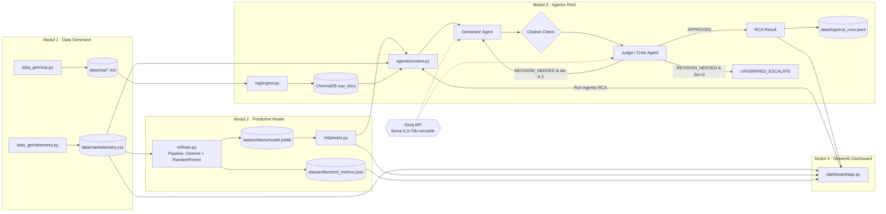

# TelcoNet-Sentinel

**OSS Network Anomaly Prediction & Self-Verified Agentic RCA Assistant**

> ⚠️ **Proyek Portofolio** — Seluruh data telemetri, SOP, dan ambang batas adalah **sintetis** (dibuat secara prosedural). Ini bukan data atau standar operasional Telkom Indonesia atau operator mana pun.

Proyek ini mensimulasikan alur kerja NOC/OSS (Operations Support System) yang nyata dengan menggabungkan **prediksi anomali ML** dan **Root Cause Analysis (RCA) berbasis agen AI berverifikasi mandiri**. Dibangun sebagai portofolio untuk target posisi di Divisi Digital Product (DDP) Telkom Indonesia.

Metodologi pengembangan: **Spec-Driven Development** — lihat folder [`specs/`](specs/) untuk requirements EARS, desain arsitektur, dan task checklist yang menjadi panduan seluruh implementasi.

---

## Arsitektur Sistem



### Loop Generator–Judge

1. **Generator Agent** membuat draft RCA (root cause, action plan, kutipan SOP).
2. **Citation Check (deterministik, non-LLM)** — setiap `sop_id + step` yang dikutip harus ada di chunk yang di-retrieve.
3. **Judge/Critic Agent** menilai faithfulness terhadap SOP (skor 1–100) dan konsistensi telemetri.
4. Jika skor < 80 **atau** ada kutipan tidak valid → `REVISION_NEEDED` → Generator merevisi (maks **2 iterasi**).
5. Jika setelah 2 iterasi masih `REVISION_NEEDED` → `UNVERIFIED_ESCALATE_TO_HUMAN`.

---

## Quick Start

> Prasyarat: Python 3.10+, virtualenv, akun Groq (untuk `LLM_MODE=groq`)

```bash
# 1. Setup environment
python3 -m venv .venv
source .venv/bin/activate        # Windows: .venv\Scripts\Activate.ps1
pip install -r requirements.txt
pip install -e .
cp .env.example .env             # isi GROQ_API_KEY

# 2. Generate data sintetis
python -m telconet_sentinel.data_gen.telemetry --seed 42 --overwrite
python -m telconet_sentinel.data_gen.sop --overwrite

# 3. Train model ML
python -m telconet_sentinel.ml.train

# 4. Ingest SOP ke ChromaDB
python -m telconet_sentinel.rag.ingest

# 5. (Opsional) Evaluasi batch agen — butuh GROQ_API_KEY
python -m telconet_sentinel.eval.evaluate_agents --n 10

# 6. Jalankan dashboard
streamlit run src/telconet_sentinel/dashboard/app.py
```

**Demo mode tanpa API key:** set `LLM_MODE=fake` di `.env` — tab Agentic RCA menggunakan respons deterministik.

### Test & Lint (offline)

```bash
LLM_MODE=fake pytest -q   # seluruh test tanpa API key
ruff check src tests       # lint
```

---

## Metrik Aktual

> Angka di bawah dihasilkan dari run aktual, bukan estimasi. Lihat `data/artifacts/` untuk file lengkap.

### ML Model (RandomForest, data sintetis 14.400 baris)

| Metrik | Nilai |
|--------|-------|
| Macro-F1 | **0.955** |
| Recall — Critical | **0.976** |
| Recall — Warning | 0.939 |
| Quality Gate | ✅ PASSED |

> ⚠️ Angka ini sangat tinggi karena label diturunkan dari aturan deterministik dan label noise hanya 2%. Pada data produksi nyata, performa akan berbeda.

### Agent Evaluation

> Tabel akan diisi setelah menjalankan `evaluate_agents --n 10` dengan Groq API key.  
> Format metrik: approval rate, faithfulness score, citation validity rate, latensi p50/p95.

Disclaimer: `sop_faithfulness_score` berasal dari LLM-as-judge (Judge Agent sendiri), **bukan** penilaian manusia. Angka ini mencerminkan konsistensi internal sistem, bukan ground truth.

---

## Stack Teknologi

| Komponen | Teknologi |
|----------|-----------|
| ML Model | `scikit-learn` RandomForestClassifier, GroupShuffleSplit |
| Vector DB | `chromadb` (lokal, persistent) |
| LLM | Groq API — `llama-3.3-70b-versatile` |
| Validasi skema | `pydantic` v2 |
| Dashboard | `streamlit` + `plotly` |
| Test | `pytest` + FakeLLM (offline) |
| Lint | `ruff` |

---

## Spec-Driven Development

Proyek ini dibangun menggunakan metodologi **Spec-Driven Development** untuk menjamin kualitas rekayasa perangkat lunak di lingkungan enterprise:

```
specs/
├── requirements.md   # 50+ requirements format EARS (ID REQ-x.y, NFR-x)
├── design.md         # Arsitektur Mermaid, skema data, desain prompt, error handling
└── tasks.md          # Checklist task berurutan dengan command verifikasi
```

Setiap modul mengacu ID requirement di docstring. Setiap commit merujuk requirement yang dipenuhi. Approach ini memastikan **traceability** dari requirement hingga implementasi dan test.

---

## Limitations

1. **Data sintetis** — Telemetri dan SOP dibuat secara prosedural. Angka baseline, threshold, dan isi SOP adalah keputusan desain, bukan standar ITU-T atau standar internal Telkom.
2. **LLM-as-judge bukan ground truth** — `sop_faithfulness_score` dihasilkan Judge Agent sendiri. Diperlukan anotasi manusia untuk evaluasi yang valid.
3. **Threshold bukan standar resmi** — Nilai `-28 dBm`, `≥ 5% packet loss`, dll. adalah parameter desain yang dapat dikalibrasi per perangkat/vendor.
4. **Groq rate limit** — Evaluasi batch > 20 insiden mungkin membutuhkan jeda antar-request (free tier).
5. **Tidak ada integrasi OSS/NMS nyata** — Tidak ada SNMP, streaming real-time, atau koneksi ke sistem produksi.

---

## Next Steps (Beyond MVP)

- [ ] Kalibrasi threshold per device type/vendor dari data historis nyata
- [ ] Evaluasi faithfulness oleh anotator NOC manusia (ground truth)
- [ ] Streaming telemetri real-time via Kafka
- [ ] Fine-tuning LLM pada data insiden jaringan nyata
- [ ] Hyperparameter search & ensemble model
- [ ] Authentication dashboard, multi-tenant, deployment ke cloud

---

## Lisensi & Penggunaan

Proyek ini dibuat untuk keperluan portofolio. Gunakan dengan menyebut bahwa data dan SOP adalah sintetis.
