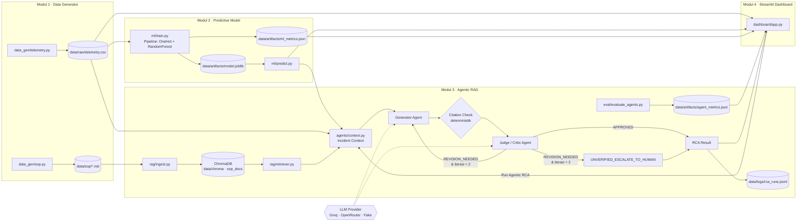
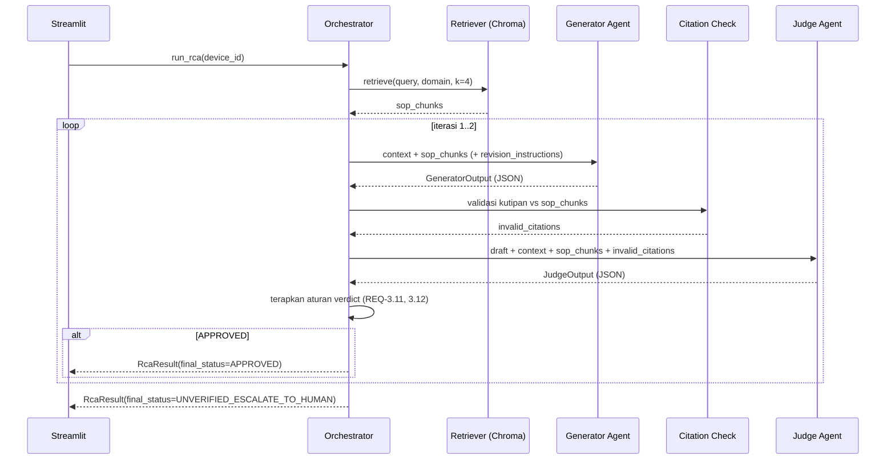

# Design — TelcoNet-Sentinel

Dokumen ini menjelaskan **bagaimana** requirement di `specs/requirements.md` dipenuhi. Setiap bagian merujuk ID requirement terkait.

> **Catatan kejujuran:** semua angka ambang batas, baseline sinyal, dan isi SOP di dokumen ini adalah **keputusan desain untuk data sintetis**, bukan standar resmi ITU-T, vendor, atau Telkom Indonesia. Saat menulis README, sebutkan hal ini secara eksplisit.

---

## 1. Arsitektur & Alur Data



### 1.1 Sequence loop Generator–Judge (REQ-3.5 s.d. 3.17)



---

## 2. Struktur Direktori

```text
telconet-sentinel/
├── CLAUDE.md
├── README.md
├── pyproject.toml                  # metadata paket + config ruff & pytest
├── requirements.txt                # dikunci setelah instalasi pertama (asumsi A4)
├── .env.example                    # GROQ_API_KEY=, GROQ_MODEL=, LLM_MODE=
├── .gitignore                      # .env, .venv/, data/chroma/, data/logs/, data/artifacts/*.joblib
├── specs/
│   ├── requirements.md
│   ├── design.md
│   └── tasks.md
├── data/
│   ├── raw/telemetry.csv           # output Modul 1 (di-generate, boleh di-commit untuk demo)
│   ├── sop/                        # 6+ SOP Markdown sintetis
│   ├── chroma/                     # ChromaDB persisten (gitignored)
│   ├── artifacts/                  # model.joblib, ml_metrics.json, agent_metrics.json
│   └── logs/rca_runs.jsonl         # log tiap run RCA (gitignored)
├── src/
│   └── telconet_sentinel/
│       ├── __init__.py
│       ├── config.py               # Settings: path, ambang, model, LLM_MODE
│       ├── schemas.py              # Pydantic: TelemetryRow, GeneratorOutput, JudgeOutput, RcaResult
│       ├── data_gen/
│       │   ├── __init__.py
│       │   ├── telemetry.py        # CLI generator CSV
│       │   ├── labeling.py         # aturan ambang → anomaly_status
│       │   └── sop.py              # CLI penulis SOP Markdown
│       ├── ml/
│       │   ├── __init__.py
│       │   ├── features.py         # daftar fitur + ColumnTransformer
│       │   ├── train.py            # CLI training + metrik
│       │   └── predict.py          # load_model(), predict_latest()
│       ├── rag/
│       │   ├── __init__.py
│       │   ├── chunking.py         # split SOP per section/step
│       │   ├── ingest.py           # CLI ingest ke Chroma
│       │   └── retriever.py        # retrieve(query, domain, k)
│       ├── agents/
│       │   ├── __init__.py
│       │   ├── llm_client.py       # GroqClient + FakeLLM (LLM_MODE=fake)
│       │   ├── prompts.py          # system prompt Generator & Judge
│       │   ├── context.py          # build_incident_context()
│       │   ├── generator.py        # generate_draft()
│       │   ├── judge.py            # citation_check() + judge_draft()
│       │   └── orchestrator.py     # run_rca(): loop maks 2 iterasi + logging
│       ├── eval/
│       │   ├── __init__.py
│       │   └── evaluate_agents.py  # CLI evaluasi batch → agent_metrics.json
│       └── dashboard/
│           ├── __init__.py
│           ├── app.py              # entry point Streamlit, 4 tab
│           └── components.py       # helper chart, badge, panel log Judge
└── tests/
    ├── conftest.py                 # set LLM_MODE=fake, tmp data dir
    ├── test_telemetry.py
    ├── test_labeling.py
    ├── test_sop.py
    ├── test_ml.py
    ├── test_rag.py
    ├── test_schemas.py
    ├── test_judge.py
    └── test_orchestrator.py
```

**Keputusan:** layout `src/` + `pip install -e .` agar `python -m telconet_sentinel...` berjalan dari root tanpa mengatur `PYTHONPATH`.

**Keputusan LLM client:** abstraksi tipis di `agents/llm_client.py` — `get_llm()` mengembalikan `GroqClient`, `OpenRouterClient`, atau `FakeLLM` sesuai `LLM_MODE`. Seluruh logika Generator/Judge/Orchestrator hanya memanggil `llm.complete_json(system, user, temperature)` sehingga pergantian provider tidak menyentuh kode di luar `llm_client.py`. OpenRouter memakai OpenAI-compatible SDK (`openai` package, `base_url` OpenRouter) sehingga tidak perlu dependensi baru jika `openai` sudah terpasang.

---

## 3. Skema Data Telemetri (`data/raw/telemetry.csv`)

### 3.1 Kolom

Kolom yang diminta user + **satu tambahan `timestamp`** (diperlukan untuk grafik time-series dan konteks 12 timestamp terakhir di REQ-3.5).

| Kolom | Tipe | Rentang valid | Keterangan |
|---|---|---|---|
| `timestamp` | string ISO-8601 | 2026-01-01T00:00:00 + n×5 menit | *Tambahan.* Waktu sampel |
| `device_id` | string | `OLT-JKT-001`, `ONT-BDG-017`, `CR-SBY-002` | `<TYPE>-<REGION3>-<NNN>` |
| `region` | kategori | `JAKARTA`, `BANDUNG`, `SURABAYA`, `MEDAN`, `MAKASSAR` | |
| `device_type` | kategori | `OLT`, `ONT`, `CORE_ROUTER` | Prefix ID: `OLT`, `ONT`, `CR` |
| `rx_optical_power_dbm` | float (2 desimal) | −40.00 s.d. 3.00 | Daya optik terima |
| `latency_ms` | float (2 desimal) | 0.50 s.d. 1000.00 | |
| `packet_loss_pct` | float (3 desimal) | 0.000 s.d. 100.000 | |
| `cpu_load_pct` | float (1 desimal) | 0.0 s.d. 100.0 | |
| `temperature_c` | float (1 desimal) | 10.0 s.d. 100.0 | |
| `anomaly_status` | kategori | `Normal`, `Warning`, `Critical` | Target ML |

Contoh baris:

```csv
timestamp,device_id,region,device_type,rx_optical_power_dbm,latency_ms,packet_loss_pct,cpu_load_pct,temperature_c,anomaly_status
2026-01-01T00:00:00,ONT-BDG-017,BANDUNG,ONT,-20.41,8.73,0.012,23.4,41.2,Normal
2026-01-01T13:35:00,ONT-BDG-017,BANDUNG,ONT,-28.62,41.10,2.310,25.1,42.0,Critical
```

**Komposisi perangkat default (50):** 10 `OLT`, 35 `ONT`, 5 `CORE_ROUTER`, region dibagi round-robin.

### 3.2 Baseline normal & aturan label (keputusan desain, REQ-1.5, 1.6)

Baseline (rata-rata ± standar deviasi Gaussian) per `device_type`:

| Metrik | OLT | ONT | CORE_ROUTER |
|---|---|---|---|
| `rx_optical_power_dbm` | −12 ± 1.5 | −20 ± 1.5 | −5 ± 1.0 |
| `latency_ms` | 5 ± 2 | 12 ± 4 | 2 ± 1 |
| `packet_loss_pct` | 0.02 ± 0.02 | 0.05 ± 0.05 | 0.01 ± 0.01 |
| `cpu_load_pct` | 40 ± 10 | 25 ± 8 | 50 ± 12 |
| `temperature_c` | 45 ± 4 | 40 ± 4 | 50 ± 5 |

Skenario gangguan (disuntikkan sebagai episode berdurasi 6–36 timestamp, efek naik bertahap):

| Skenario | Device type | Efek |
|---|---|---|
| `FIBER_DEGRADATION` | OLT, ONT | rx turun 6–14 dB, packet loss naik 0.5–6% |
| `CONGESTION` | semua | latency ×4–15, packet loss naik 1–8% |
| `OVERHEATING` | OLT, CORE_ROUTER | suhu naik 15–35 °C, CPU naik 10–30 poin |
| `CPU_SPIKE` | OLT, CORE_ROUTER | CPU naik ke 85–100%, latency ×2–4 |

Aturan label (dievaluasi berurutan, kondisi pertama yang terpenuhi menang):

| Status | Kondisi (salah satu terpenuhi) |
|---|---|
| `Critical` | rx ≤ −28.0 (OLT/ONT) · packet_loss ≥ 5.0 · latency ≥ 150 · cpu ≥ 95 · suhu ≥ 75 |
| `Warning` | rx ≤ −25.0 (OLT/ONT) · packet_loss ≥ 1.0 · latency ≥ 60 · cpu ≥ 85 · suhu ≥ 65 |
| `Normal` | selain di atas |

Setelah itu 2% baris dibalik labelnya secara acak ke kelas tetangga (Normal↔Warning, Warning↔Critical) sebagai label noise. Probabilitas & durasi episode di-tuning (konstanta di `config.py`) sampai distribusi REQ-1.5 tercapai.

Contoh syntax (ilustrasi, bukan implementasi lengkap):

```python
rng = np.random.default_rng(seed)
df["anomaly_status"] = np.select([is_critical, is_warning], ["Critical", "Warning"], default="Normal")
```

### 3.3 Format dokumen SOP (`data/sop/*.md`, REQ-1.7, 1.8)

Minimal 6 dokumen:

| `sop_id` | Domain | Judul |
|---|---|---|
| `SOP-FTTH-001` | FTTH | Penanganan Redaman Optik Tinggi di Sisi ONT |
| `SOP-FTTH-002` | FTTH | Penanganan Packet Loss Pelanggan FTTH |
| `SOP-OLT-001` | OLT | Penanganan Overheating Shelf OLT |
| `SOP-OLT-002` | OLT | Penanganan CPU Tinggi pada OLT |
| `SOP-CORE-001` | CORE | Penanganan Kongesti Link Core |
| `SOP-CORE-002` | CORE | Penanganan Lonjakan Latensi Core Router |

Template tiap file:

```markdown
---
sop_id: SOP-FTTH-001
domain: FTTH
applies_to: [ONT, OLT]
synthetic: true
---
# SOP-FTTH-001 — Penanganan Redaman Optik Tinggi di Sisi ONT
> Dokumen sintetis untuk proyek portofolio. Bukan SOP resmi operator mana pun.

## Gejala
## Ambang Pemicu
## Diagnosis
Step 1: ...
## Tindakan
Step 1: ...
## Eskalasi
```

Mapping `device_type` → domain retrieval: `ONT` → `[FTTH]`, `OLT` → `[FTTH, OLT]`, `CORE_ROUTER` → `[CORE]`.

---

## 4. Skema JSON Agen

Semua skema diimplementasi sebagai model Pydantic di `src/telconet_sentinel/schemas.py`. Output LLM di-parse dengan `Model.model_validate_json(...)`.

### 4.1 `GeneratorOutput` (REQ-3.6, 3.7)

| Field | Tipe | Aturan |
|---|---|---|
| `incident_id` | string | `INC-<device_id>-<timestamp ringkas>` |
| `device_id` | string | sama dengan input |
| `predicted_status` | enum `Warning`/`Critical` | dari ML |
| `root_cause_hypothesis` | string | ≤ 400 karakter |
| `root_cause_category` | enum | `FIBER_DEGRADATION`, `CONGESTION`, `OVERHEATING`, `CPU_SPIKE`, `UNKNOWN` |
| `telemetry_evidence` | list[object] | tiap item: `metric`, `observed_value`, `threshold`, `interpretation` |
| `action_plan` | list[object] | 1–6 item; tiap item: `step_no`, `action`, `sop_reference` {`sop_id`, `step`}, `priority` (`P1`/`P2`/`P3`) |
| `confidence` | float | 0.0–1.0, self-reported (bukan probabilitas terkalibrasi) |
| `status_flag` | enum | `OK` atau `INSUFFICIENT_SOP_CONTEXT` |
| `iteration` | int | 1 atau 2 |

Contoh:

```json
{
  "incident_id": "INC-ONT-BDG-017-20260101T1335",
  "device_id": "ONT-BDG-017",
  "predicted_status": "Critical",
  "root_cause_hypothesis": "Redaman optik naik bertahap ~8 dB dalam 1 jam disertai packet loss, konsisten dengan degradasi fiber/konektor di jalur drop.",
  "root_cause_category": "FIBER_DEGRADATION",
  "telemetry_evidence": [
    {"metric": "rx_optical_power_dbm", "observed_value": -28.62, "threshold": -28.0, "interpretation": "Melewati ambang Critical"},
    {"metric": "packet_loss_pct", "observed_value": 2.31, "threshold": 1.0, "interpretation": "Melewati ambang Warning"}
  ],
  "action_plan": [
    {"step_no": 1, "action": "Verifikasi rx power ONT dan OLT port terkait dari NMS", "sop_reference": {"sop_id": "SOP-FTTH-001", "step": 1}, "priority": "P1"},
    {"step_no": 2, "action": "Dispatch teknisi untuk cek & bersihkan konektor di ODP", "sop_reference": {"sop_id": "SOP-FTTH-001", "step": 3}, "priority": "P1"}
  ],
  "confidence": 0.78,
  "status_flag": "OK",
  "iteration": 1
}
```

### 4.2 `JudgeOutput` (REQ-3.9 s.d. 3.12)

| Field | Tipe | Aturan |
|---|---|---|
| `incident_id` | string | sama dengan draft |
| `iteration` | int | 1 atau 2 |
| `sop_faithfulness_score` | int | 1–100 (rubrik di §5.2) |
| `telemetry_consistency_score` | int | 1–100: apakah evidence cocok dengan angka telemetri |
| `verdict` | enum | `APPROVED` / `REVISION_NEEDED` (dipaksa ulang oleh aturan REQ-3.11, 3.12) |
| `issues` | list[object] | tiap item: `type` (`UNSUPPORTED_ACTION`, `WRONG_CITATION`, `TELEMETRY_MISMATCH`, `MISSING_STEP`, `OTHER`), `detail`, `severity` (`HIGH`/`MEDIUM`/`LOW`) |
| `invalid_citations` | list[object] | diisi oleh citation check deterministik, bukan LLM |
| `revision_instructions` | string | wajib tidak kosong jika `REVISION_NEEDED` |
| `rationale` | string | ≤ 500 karakter |

Contoh:

```json
{
  "incident_id": "INC-ONT-BDG-017-20260101T1335",
  "iteration": 1,
  "sop_faithfulness_score": 64,
  "telemetry_consistency_score": 90,
  "verdict": "REVISION_NEEDED",
  "issues": [
    {"type": "UNSUPPORTED_ACTION", "detail": "Action 'ganti modul SFP OLT' tidak ada di SOP-FTTH-001.", "severity": "HIGH"}
  ],
  "invalid_citations": [
    {"sop_id": "SOP-FTTH-001", "step": 7}
  ],
  "revision_instructions": "Hapus tindakan penggantian SFP atau kutip langkah SOP yang mendukung. SOP-FTTH-001 hanya memiliki Step 1-5.",
  "rationale": "Diagnosis sesuai telemetri, tetapi satu tindakan dan satu kutipan tidak didukung konteks SOP."
}
```

### 4.3 `RcaResult` (output orchestrator, ke UI & log)

| Field | Tipe |
|---|---|
| `incident_id` | string |
| `final_status` | `APPROVED` / `UNVERIFIED_ESCALATE_TO_HUMAN` / `ERROR` |
| `final_draft` | `GeneratorOutput` atau null |
| `iterations` | list[{`draft`: GeneratorOutput, `judge`: JudgeOutput, `latency_ms`: float}] |
| `retrieved_sop_ids` | list[string] |
| `total_latency_ms` | float |
| `model` | string (nilai `GROQ_MODEL` yang dipakai) |
| `error` | string atau null |

Satu baris `data/logs/rca_runs.jsonl` = satu `RcaResult` yang di-serialize + `logged_at`.

---

## 5. Desain Prompt (ringkas)

Isi prompt lengkap ditulis di `agents/prompts.py` saat implementasi. Prinsip:

### 5.1 Generator (system prompt)
- Peran: NOC engineer L2 yang menyusun RCA.
- Hanya boleh memakai tindakan dari blok `<SOP_CONTEXT>`; setiap action wajib punya `sop_reference`.
- Jika tidak ada SOP relevan → `status_flag = INSUFFICIENT_SOP_CONTEXT`, `action_plan` berisi satu langkah eskalasi.
- Output: JSON saja, sesuai skema (skema disisipkan di prompt).
- Pada iterasi 2: blok `<JUDGE_FEEDBACK>` berisi `issues` + `revision_instructions`.

### 5.2 Judge (system prompt) — rubrik `sop_faithfulness_score`
| Rentang | Arti |
|---|---|
| 90–100 | Semua tindakan & kutipan didukung SOP, urutan sesuai |
| 80–89 | Didukung SOP, ada kekurangan minor (urutan / detail) |
| 50–79 | ≥ 1 tindakan tidak didukung SOP atau kutipan salah |
| 1–49 | Mayoritas tindakan tidak didukung / bertentangan dengan SOP |

- Judge tidak menulis ulang RCA; hanya menilai dan memberi instruksi revisi.
- Hasil citation check deterministik disisipkan ke prompt Judge sebagai fakta.

### 5.3 Panggilan LLM (contoh syntax per provider)

**Groq** (`LLM_MODE=groq`, pakai `groq` SDK):
```python
from groq import Groq
client = Groq(api_key=settings.groq_api_key, timeout=settings.llm_timeout_s)
resp = client.chat.completions.create(
    model=settings.groq_model, messages=msgs,
    temperature=0.0, response_format={"type": "json_object"},
)
```

**OpenRouter** (`LLM_MODE=openrouter`, pakai `openai` SDK dengan base_url):
```python
from openai import OpenAI
client = OpenAI(
    api_key=settings.openrouter_api_key,
    base_url="https://openrouter.ai/api/v1",
    timeout=settings.llm_timeout_s,
)
resp = client.chat.completions.create(
    model=settings.openrouter_model, messages=msgs,
    temperature=0.0, response_format={"type": "json_object"},
)
```

Kedua panggilan menghasilkan objek `resp` dengan interface yang sama (`resp.choices[0].message.content`), sehingga `complete_json()` dapat memakai kode parsing yang identik. (Asumsi A2, A6: dukungan `response_format` perlu diverifikasi per model.)

---

## 6. Konfigurasi (`config.py` + `.env`)

| Variabel | Default | Keterangan |
|---|---|---|
| `LLM_MODE` | `groq` | `groq`, `openrouter`, atau `fake` (REQ-3.26) |
| `GROQ_API_KEY` | — | Wajib jika `LLM_MODE=groq` |
| `GROQ_MODEL` | `qwen/qwen3.8-27b` | Model Groq aktif per Nov 2026 (JSON mode ✓, ctx=131k). `llama-3.3-70b-versatile` sudah deprecated. |
| `OPENROUTER_API_KEY` | — | Wajib jika `LLM_MODE=openrouter` |
| `OPENROUTER_MODEL` | `meta-llama/llama-3.3-70b-instruct` | Default OpenRouter (JSON mode ✓, ctx=131k, $0.20/$0.52 per 1M). Alternatif diverifikasi: lihat `.env.example`. |
| `OPENROUTER_BASE_URL` | `https://openrouter.ai/api/v1` | Tidak perlu diubah kecuali ada proxy |
| `LLM_TIMEOUT_S` | `30` | REQ-3.18 |
| `APPROVAL_THRESHOLD` | `80` | REQ-3.12 |
| `MAX_ITERATIONS` | `2` | REQ-3.14 |
| `RETRIEVAL_K` | `4` | REQ-3.4 |
| `DATA_DIR` | `data` | Root semua artefak |

Nilai `OPENROUTER_BASE_URL` dan `OPENROUTER_MODEL` didefinisikan sebagai default di `config.py` — user hanya perlu mengisi `OPENROUTER_API_KEY` di `.env` untuk beralih ke OpenRouter.

---

## 7. Penanganan Error

| Kondisi | Perilaku |
|---|---|
| CSV / model belum ada | Dashboard menampilkan command yang harus dijalankan (REQ-4.9) |
| API key kosong untuk provider aktif | Tab Agentic RCA menampilkan pesan yang menyebut provider dan nama env var yang harus diisi; tab lain normal (REQ-3.18) |
| `LLM_MODE` tidak dikenali | Crash saat startup dengan `ValueError` yang eksplisit (REQ-3.26) |
| JSON LLM invalid | Retry 1× dengan pesan "perbaiki JSON sesuai skema", lalu `ERROR` (REQ-3.17) |
| HTTP 429 / timeout (Groq atau OpenRouter) | Satu retry dengan jeda 2 detik, lalu `ERROR` dengan pesan rate limit dan nama provider |
| Koleksi Chroma kosong | Orchestrator mengembalikan `ERROR` "jalankan rag.ingest" |

---

## 8. Strategi Pengujian

- Semua test berjalan dengan `LLM_MODE=fake` (di-set di `tests/conftest.py`), tanpa jaringan.
- `FakeLLM` mengembalikan respons JSON dari antrean yang bisa diatur per test, sehingga bisa mensimulasikan: approve di iterasi 1, revisi lalu approve, gagal 2× (eskalasi), dan JSON rusak.
- Test ML memakai dataset kecil (mis. 10 perangkat × 50 step) di `tmp_path` agar cepat (< 30 detik total, target).
- Test RAG memakai direktori Chroma sementara di `tmp_path`.
- Smoke test dashboard: `streamlit.testing.v1.AppTest` (asumsi: tersedia di versi Streamlit yang terpasang; jika tidak, cukup test import modul).

---

## 9. Metrik Evaluasi Sistem

| Area | Metrik | Sumber |
|---|---|---|
| ML | macro-F1, recall/precision per kelas, confusion matrix, top feature importance | `ml_metrics.json` |
| Agen | approval rate iterasi-1 & final, rata-rata faithfulness, rata-rata iterasi, citation validity rate, escalation rate, latensi p50/p95 | `agent_metrics.json` |

Narasi untuk recruiter (tulis di README): *"Critic menurunkan risiko halusinasi"* hanya boleh diklaim jika didukung angka, misalnya perbandingan citation validity rate iterasi-1 vs final dari `agent_metrics.json`.
